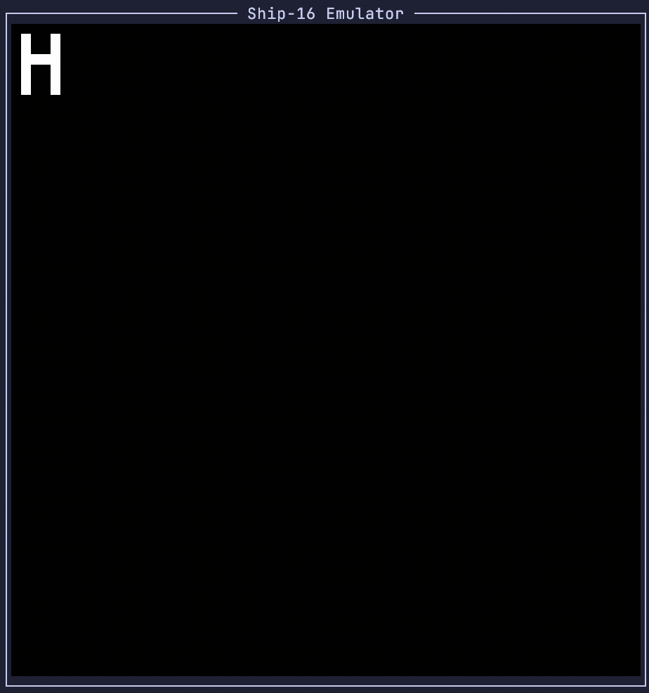
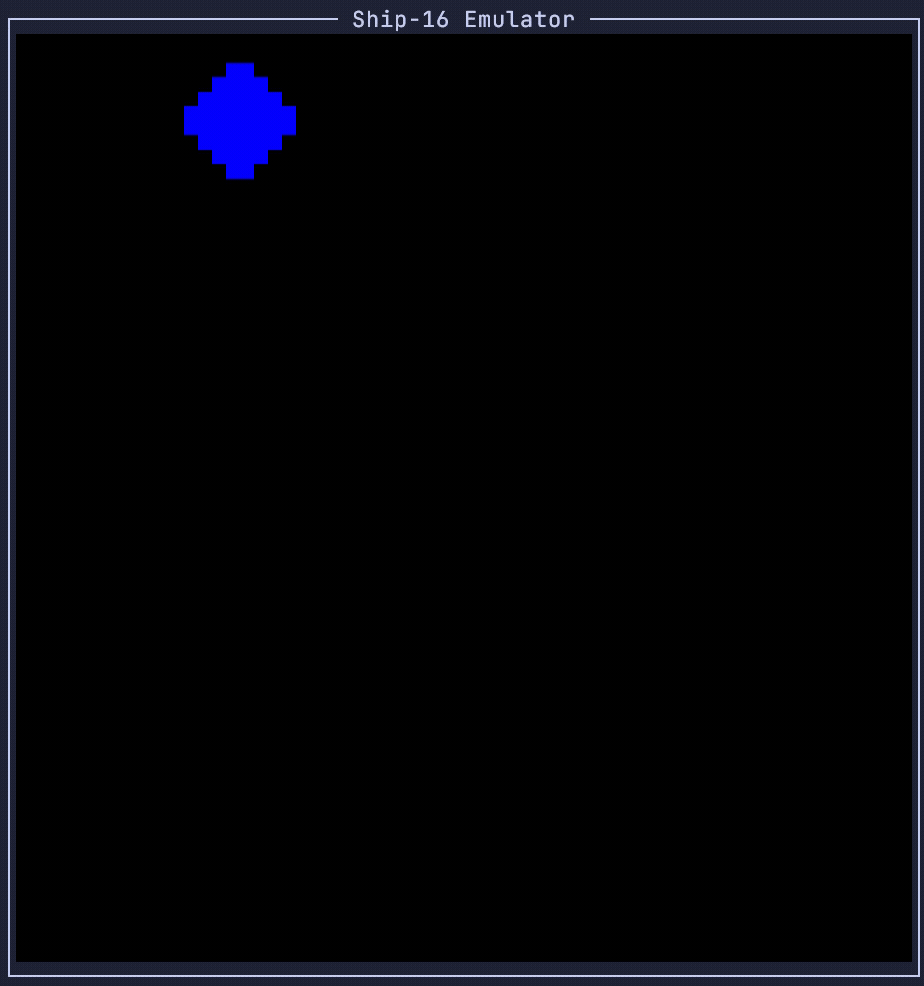
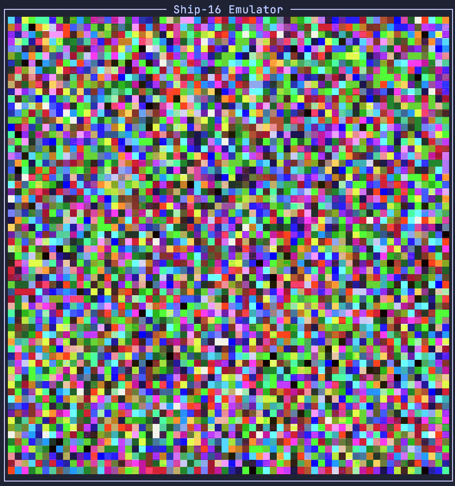
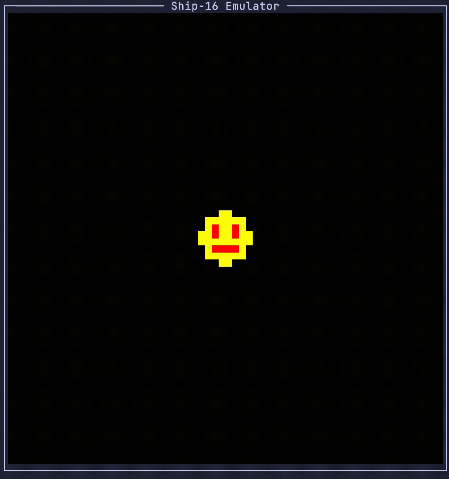
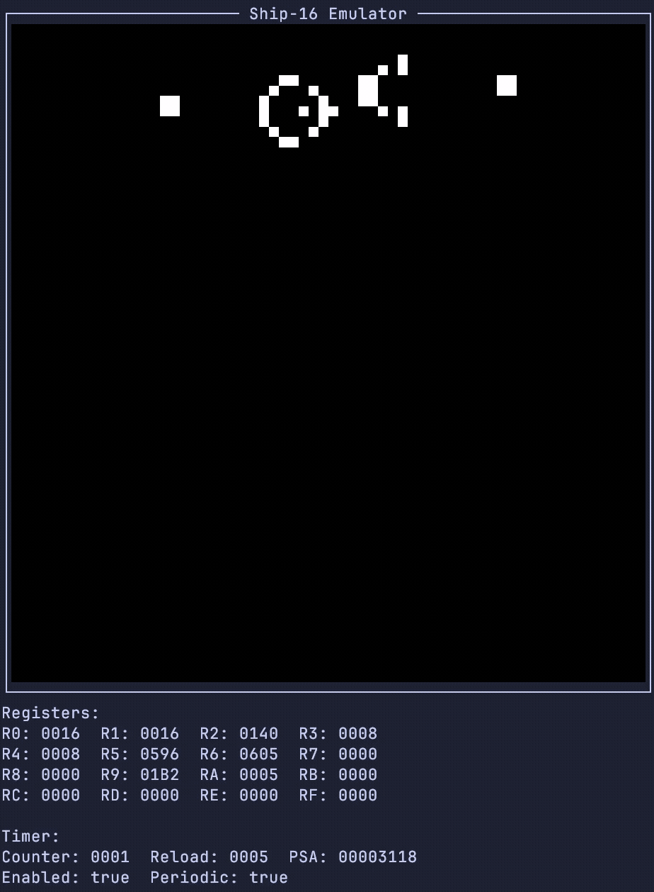

<div align="center">
  
  <h1>Ship-16</h1>

<div>
    
  
  
</div>
<p>
  SHIP-16 is an experimental 16-bit virtual computer implemented in Rust. It includes a custom instruction set, an assembler, and an emulator with memory, graphics, and input systems. Its design and specifications are documented in the accompanying technical specification.
  </p>
</div>

> [!NOTE]
> For the complete technical specification, see **[the specification](./spec.pdf)**.

## Getting Started

Clone the repository:

```bash
git clone https://github.com/tathyagarg/ship-16
cd ship-16
```

Build the project:

```bash
cargo build --release
```

Run an example program:

```bash
cargo run -p ship16-rs --release -- --rom roms/hello_world.rom
```

## About

SHIP-16 is designed as a simple virtual computer intended to be a step-up from the CHIP-8 architecture. It features a 16-bit architecture, a custom instruction set, simple graphics system, and keyboard input. The example emulator is implemented in Rust.

The source consists of three crates:
- `ship16-rs`: The emulator implementation in Rust.
- `isa`: The instruction set architecture definition.
- `asm`: The assembler implementation.

## Demos

| Demo | Preview | Note |
| :--- | :--- | :--- |
| Hello World |  | |
| Bounce |  | |
| BSOD |  | The screen turns blue when any (recognized) key is pressed. |
| Sprite Demo |  | The smiley (both neutral and smiling) is a custom sprite encoded in the ROM. It can be controlled with keyboard input. When smiling, the sprite moves faster. |
| Conway's Game of Life (Gosper Glider Gun) |  | A simple implementation of Conway's Game of Life (Made by AI) Not shown in the video is the pre-simulation mode where you can set up the starting state of the board with the help of a controllable cursor (1: left, 2: right, 0: up, 9: down, F: toggle dead/alive, A: start simulation). After starting the simulation, step through the iterations by pressing B or toggle the automatic mode by pressing E. |

## License

SHIP-16 is licensed under the [WTFPL](http://www.wtfpl.net/). Do whatever you want with it.
