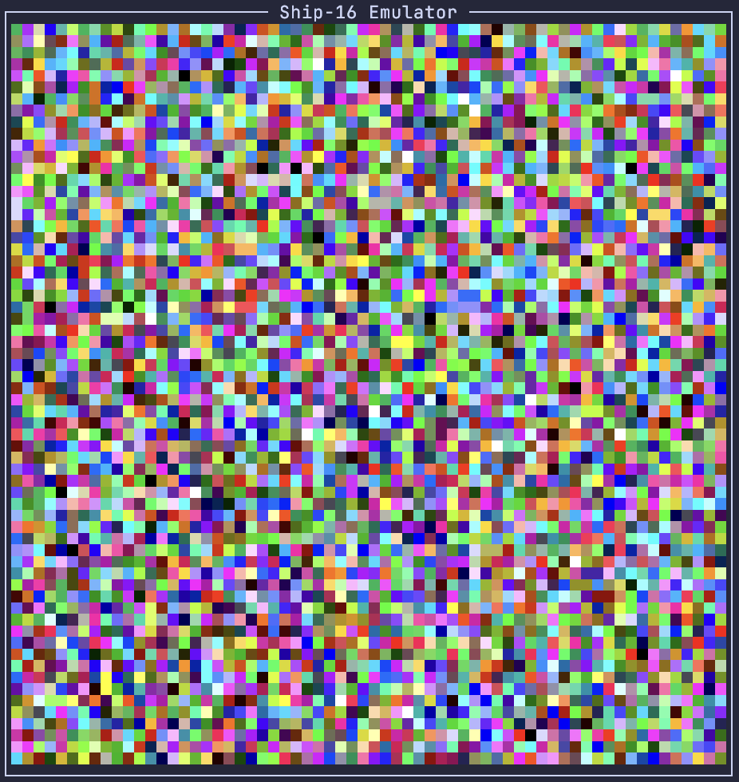

<div align="center">
  
  <h1>Ship-16</h1>

<div>
    
  
  
</div>
<p>
  SHIP-16 is an experimental 16-bit virtual computer implemented in Rust. It includes a custom instruction set, an assembler, and an emulator with memory, graphics, and input systems. Its design and specifications are documented in the accompanying technical specification.
  </p>
</div>

## Overview

SHIP-16 is an experimental virtual computer built from the ground up, featuring its own instruction set, memory model, graphics system, and assembly language.

For the complete technical specification, see **[the specification](./spec.pdf)**.

## Getting Started

Clone the repository:

```bash
git clone https://github.com/tathyagarg/ship-16
cd ship-16
```

Build the project:

```bash
cargo build --release
```

Run an example program:

```bash
cargo run --bin asm -- --input crates/asm/in/bsod.s --output output.rom &> /dev/null
cargo run --bin ship16 -- --rom output.rom
```

### Expected Output

When you run the example program, you should see rapidly changing random colors on the screen, that turn into a completely blue screen when you press any key (0-9, a-f). Example:


## License

SHIP-16 is licensed under the [WTFPL](http://www.wtfpl.net/). Do whatever you want with it.
